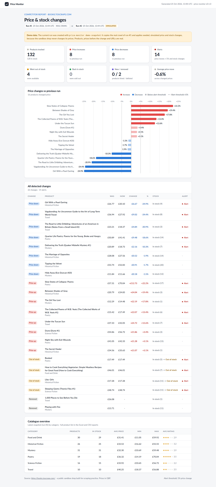
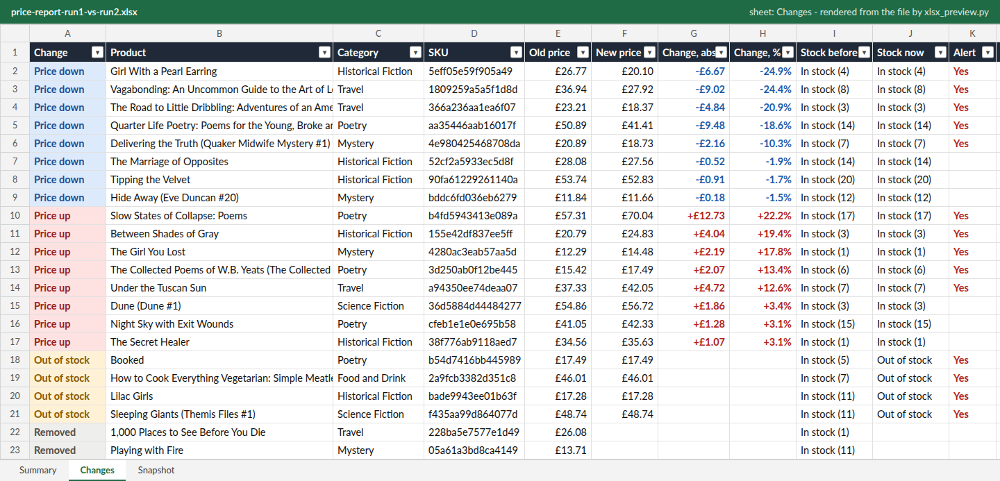
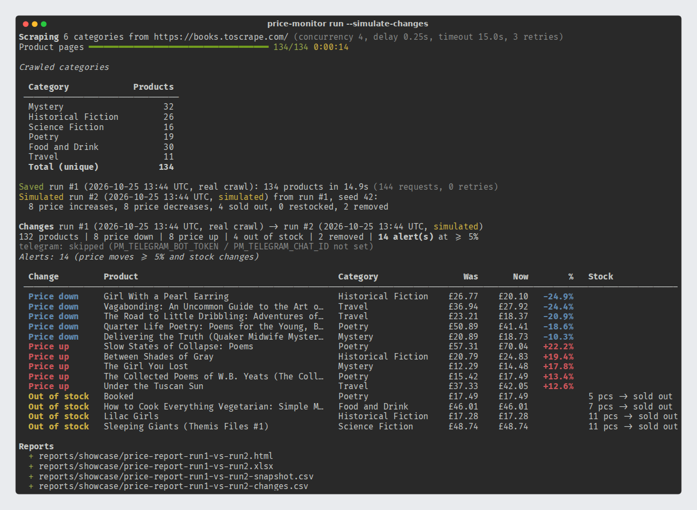

# Price Monitor

**Competitor price & stock monitoring for online shops**: an async Python scraper that
collects product prices and availability, stores a snapshot per run in SQLite, detects
what changed since the last run and delivers the result as an HTML dashboard, an Excel
workbook, CSV files and alerts (terminal or Telegram).

This is a portfolio project. It runs against
[books.toscrape.com](https://books.toscrape.com), a public sandbox shop built for scraping
practice, so it is safe to try and easy to read before adapting it to a real store.



> **About the demo data.** The sandbox shop never changes its prices or stock, so two real
> crawls are always identical. To show change detection, the screenshots compare a **real
> crawl** (run #1) with a **simulated** follow-up snapshot (run #2) created by
> `price-monitor demo-snapshot`. The simulation copies the real products and applies
> seeded, reproducible edits (price moves, sell-outs, delistings). Product names, URLs and
> the "before" prices are real; **the changes are simulated**. Every report labels
> simulated runs as such.

---

## The problem

Online shops lose margin and sales when a competitor quietly drops a price or runs out of
a product they also sell. Checking competitor pages by hand does not scale beyond a few
dozen products and gives no history. Price Monitor automates the routine:

1. crawl the competitor catalogue on a schedule;
2. keep every snapshot, so there is a history to compare against;
3. report only what changed, with a threshold so small moves do not create noise;
4. push the important changes to the people who act on them.

## Features

- **Async, polite scraper** (`httpx` + `selectolax`): category discovery, pagination,
  product pages with price, availability and units in stock, rating, URL and UPC (used as SKU).
  - concurrency limit (default 4), a pause after each request, timeouts;
  - retries with exponential backoff and jitter for timeouts, connection errors,
    HTTP 429 and 5xx, honouring `Retry-After`;
  - `robots.txt` check and an identifying `User-Agent`.
- **SQLite storage** with one snapshot per run; schema creation is idempotent; prices stored
  as integer minor units (no float rounding); a run is written in a single transaction.
- **Change detection** between the two latest runs: price up/down (absolute and %),
  out of stock / back in stock, new / removed products. A configurable **alert threshold**
  (default: price change of 5 % or more) decides what is pushed as an alert.
- **Safe by default**: if any page fails after retries, the snapshot is **not** saved,
  because a partial snapshot would report false "removed" products.
- **Reports**
  - self-contained **HTML** (inline CSS + inline SVG chart, no JavaScript, no external
    assets, light/dark aware): summary cards, a diverging bar chart of price moves,
    the full change table and a category overview;
  - **Excel** (`openpyxl`): Summary, Changes and Snapshot sheets, styled header, frozen
    header row, autofilter, currency/percent number formats and real conditional
    formatting (colours survive sorting and filtering);
  - **CSV** for the latest snapshot and for the changes (UTF-8 with BOM, opens cleanly in Excel);
  - optional **Google Sheet** (`-f sheets`): the same Summary, Changes and Snapshot sheets,
    replaced on every run, prices as numbers (see [Google Sheets](#google-sheets)).
- **Pluggable notifiers**: console (rich table) and Telegram Bot API. Telegram is enabled only
  when a token and chat id are configured; the token is never logged.
- **CLI** (`typer`) and configuration through environment variables or `.env`
  (`pydantic-settings`).
- **Tests**: parsing from saved HTML fixtures, crawler/fetcher behaviour against an in-memory
  HTTP transport, storage, diff rules, demo simulation, Excel/CSV/HTML generation, notifier
  selection and CLI flows. No network access in tests.

## Quick start

Requires Python 3.11+.

```bash
git clone <this repository> price-monitor-demo
cd price-monitor-demo
python -m venv .venv && source .venv/bin/activate
pip install -e ".[dev]"

# Real crawl + simulated follow-up snapshot + diff + reports + alerts, in one command:
price-monitor run --simulate-changes
```

Reports are written to `reports/`, the database to `data/price_monitor.db`.
The default crawl covers six categories (134 products, 144 HTTP requests) and took
about 15 seconds when the sample output below was recorded.

## CLI usage

| Command | What it does |
|---|---|
| `price-monitor scrape [-c "Travel,Poetry"]` | Crawl the configured categories and store a new snapshot. |
| `price-monitor demo-snapshot [--seed 42]` | **Demo only.** Store a simulated follow-up snapshot derived from the latest run. |
| `price-monitor diff [-t 5] [--notify]` | Show changes between the two latest runs; `--notify` sends alerts to all configured notifiers. |
| `price-monitor report [-o DIR] [-f html,xlsx,csv,sheets] [-t 5]` | Write the reports for the latest run and its changes. `sheets` is opt-in (not in the default set), see [Google Sheets](#google-sheets). |
| `price-monitor run [--simulate-changes] [-o DIR]` | Full pipeline: scrape, diff, alerts, reports. |
| `price-monitor runs` | List stored runs (real or simulated). |

Global options: `--db PATH` (use another SQLite file), `-v/--verbose`, `--version`.

Step by step, the same flow as `run --simulate-changes`:

```bash
price-monitor scrape          # real crawl -> run #1
price-monitor demo-snapshot   # simulated changes -> run #2
price-monitor diff            # print every change in the terminal
price-monitor report          # HTML + Excel + CSV in reports/
```

Exit codes: `0` success, `1` failure (site unreachable, pages failed, no runs yet),
`2` invalid input (unknown category or report format, missing Google Sheets settings).
With `-f sheets`, `1` also means Google refused access to the spreadsheet.

## Configuration

Copy `.env.example` to `.env`; every value is optional. The most useful settings:

| Variable | Default | Meaning |
|---|---|---|
| `PM_CATEGORIES` | six categories | Comma-separated category names as shown in the shop sidebar |
| `PM_CONCURRENCY` | `4` | Parallel requests (capped at 8) |
| `PM_REQUEST_DELAY` | `0.25` | Pause after each request, seconds |
| `PM_TIMEOUT` / `PM_MAX_RETRIES` | `15` / `3` | Per-request timeout and retry budget |
| `PM_ALERT_THRESHOLD_PCT` | `5` | Price change (in %) that triggers an alert |
| `PM_ALERT_ON_NEW_REMOVED` | `false` | Also alert on new / removed products |
| `PM_DB_PATH` / `PM_REPORTS_DIR` | `data/price_monitor.db` / `reports` | Output locations |
| `PM_TELEGRAM_BOT_TOKEN` / `PM_TELEGRAM_CHAT_ID` | empty | Enable the Telegram notifier |
| `PM_GOOGLE_SERVICE_ACCOUNT_FILE` | empty | Path to the service account JSON key (needed for `-f sheets`) |
| `PM_GOOGLE_SHEET_ID` | empty | Spreadsheet ID or its full URL (needed for `-f sheets`) |

Alert rules: a price change is an alert when it moves by at least the threshold (compared on
the exact ratio, so 4.99 % is not 5 %); a product going out of stock or back in stock is always
an alert; new and removed products are always reported and become alerts only when
`PM_ALERT_ON_NEW_REMOVED=true`.

## Google Sheets

Optional output for teams that work in a spreadsheet instead of Excel files.

1. Install the extra: `pip install -e ".[sheets]"` (adds `gspread`; the base install does not need it).
2. In the [Google Cloud console](https://console.cloud.google.com/) create a project, enable
   the **Google Sheets API**, create a **service account** and download a JSON key for it.
3. Create an empty Google Sheet and **share it (as Editor) with the service account's e-mail**
   (the `client_email` value in the key file).
4. Set the two variables (in `.env` or the environment) and run:

```bash
export PM_GOOGLE_SERVICE_ACCOUNT_FILE=secrets/service-account.json   # keep it out of git
export PM_GOOGLE_SHEET_ID="https://docs.google.com/spreadsheets/d/<ID>/edit"   # or just <ID>
price-monitor report -f sheets            # or: price-monitor run -f html,xlsx,csv,sheets
```

The worksheets `Summary`, `Changes` and `Snapshot` are created when missing and their contents
are replaced on every run (other worksheets are not touched). Prices, deltas and percentages are
numbers, so the sheet can sort and sum them. If the service account cannot see the sheet, the
command says so and prints the e-mail to share with; the key itself is never printed.

**Not run live in this demo:** the Sheets writer is covered by offline tests against a fake
`gspread` client, and the `gspread` calls were checked against its installed source. It has not
been run against a real Google account, because no Google credentials were available.

## Sample output

Recorded from a real run of `price-monitor run --simulate-changes`
(full text in [`examples/run-output.txt`](examples/run-output.txt)):

```text
Scraping 6 categories from https://books.toscrape.com/ (concurrency 4, delay 0.25s, timeout 15.0s, 3 retries)
Product pages ━━━━━━━━━━━━━━━━━━━━━━━━━━━━━━━━━━━━ 134/134 0:00:14

Saved run #1 (2026-10-25 13:44 UTC, real crawl): 134 products in 14.9s (144 requests, 0 retries)
Simulated run #2 (2026-10-25 13:44 UTC, simulated) from run #1, seed 42:
  8 price increases, 8 price decreases, 4 sold out, 0 restocked, 2 removed

Changes run #1 (2026-10-25 13:44 UTC, real crawl) -> run #2 (2026-10-25 13:44 UTC, simulated)
132 products | 8 price down | 8 price up | 4 out of stock | 2 removed | 14 alert(s) at >= 5%
telegram: skipped (PM_TELEGRAM_BOT_TOKEN / PM_TELEGRAM_CHAT_ID not set)
Alerts: 14 (price moves >= 5% and stock changes)

  Change         Product                                        Category                 Was       Now        %   Stock
 ───────────────────────────────────────────────────────────────────────────────────────────────────────────────────────────────────
  Price down     Girl With a Pearl Earring                      Historical Fiction    £26.77    £20.10   -24.9%
  Price up       Slow States of Collapse: Poems                 Poetry                £57.31    £70.04   +22.2%
  Out of stock   Booked                                         Poetry                £17.49    £17.49            5 pcs -> sold out
  ...
```

The reports for those two runs are committed in [`examples/`](examples/):
[HTML](examples/price-report-run1-vs-run2.html),
[Excel](examples/price-report-run1-vs-run2.xlsx),
[changes CSV](examples/price-report-run1-vs-run2-changes.csv) and
[snapshot CSV](examples/price-report-run1-vs-run2-snapshot.csv).

## Screenshots

**HTML report** (top of this page): summary cards, price-move chart with the alert threshold,
every change and a catalogue overview.

**Excel report, Changes sheet.** Rendered to an image from the committed `.xlsx` by
[`scripts/xlsx_preview.py`](scripts/xlsx_preview.py), which reads the file back with openpyxl
(values, number formats, column widths, header styles and the conditional-formatting rules);
it is not a screenshot of Excel itself. A test checks that the preview reflects the workbook.



**Terminal output of `price-monitor run --simulate-changes`**, captured as ANSI text from the
real run above and rendered with rich's SVG export.



To regenerate the images: `pip install -e ".[screenshots]"`, capture the run output with
`TTY_COMPATIBLE=1 TTY_INTERACTIVE=0 COLUMNS=132 price-monitor run --simulate-changes > run.ansi`,
then `python scripts/capture_screenshots.py --html ... --xlsx ... --console-log run.ansi`.

## How it works

```text
shop pages ──► PoliteFetcher ──► parsers ──► Storage (SQLite: runs + snapshots)
               (httpx, async)    (selectolax)        │
                                                     │ latest two runs
                                                     ▼
                                          diff.detect_changes()
                                                     │ DiffResult
                                   ┌─────────────────┴─────────────────┐
                                   ▼                                   ▼
                     notifiers: console, Telegram       reports: HTML, Excel, CSV
```

```text
src/price_monitor/
├── cli.py               # typer commands
├── config.py            # pydantic-settings (PM_* variables, .env)
├── models.py            # Product, Run, Change, ChangeType
├── scraper/
│   ├── http.py          # PoliteFetcher: concurrency, delay, retries, robots.txt
│   ├── parsers.py       # pure functions: HTML -> data (site-specific part)
│   └── crawler.py       # categories -> pagination -> product pages
├── storage.py           # SQLite snapshots
├── diff.py              # change detection, alert rules, summary
├── demo.py              # simulated follow-up snapshot (demo only)
├── reports/             # html.py + templates/, chart.py (SVG), excel.py, csv_export.py, sheets.py
└── notifiers/           # base.py, console.py, telegram.py, build_notifiers()
```

## Adapting it to a real shop

The site-specific code is deliberately small: `scraper/parsers.py` (CSS selectors) and the
crawl order in `scraper/crawler.py`. Typical steps for a client project:

- **One parser module per competitor site** behind the same `Product` model; the rest of the
  pipeline (storage, diff, reports, alerts) stays unchanged.
- **Prefer structured data when it exists**: many shops expose JSON-LD `Product`/`Offer`
  markup, sitemaps or public product feeds, which are faster and more stable than HTML selectors.
- **JavaScript-rendered shops**: swap the fetcher for a headless browser (Playwright) for those
  pages only; keep the async, rate-limited structure.
- **Match competitor products to your own catalogue** by GTIN/EAN where available, otherwise
  by brand + model or fuzzy title matching with a manual review list.
- **Act on the data**: feed the changes into WooCommerce or Shopify (price suggestions or
  repricing rules with floor/ceiling guardrails), or into a Google Sheet for the buying team.
- **Scheduling and scale**: cron, a systemd timer, GitHub Actions or a task queue; PostgreSQL
  instead of SQLite for many sites and long history; more notifiers (e-mail, Slack, webhooks)
  by subclassing `Notifier`.
- **Stay compliant**: respect each site's terms of use and `robots.txt`, keep request rates
  low, identify the crawler, and collect only public product data.

## Tests and code quality

```bash
pytest          # unit tests + doctests, offline (no network), about a second
ruff check . && ruff format --check .
```

Covered: parsers (on saved pages from the sandbox site; one derived out-of-stock variant is
marked as such in the file), pagination and de-duplication, retries/backoff/`Retry-After`,
non-retried 4xx, robots.txt, the concurrency limit, failed pages not being dropped silently,
storage round-trips and transactions, every change type and the threshold boundary, the demo
simulation, Excel structure and conditional formatting, CSV columns, HTML escaping and the demo
banner, Google Sheets output (against a fake `gspread` client: rows, numbers, replacement on
rerun, missing settings, no access), Telegram formatting/splitting/error handling (with a
mocked transport) and the CLI flows.

## Docker

```bash
docker build -t price-monitor .
docker run --rm -v "$PWD/data:/app/data" -v "$PWD/reports:/app/reports" price-monitor run
```

## License

MIT, see [LICENSE](LICENSE). Author: Aleks T.
